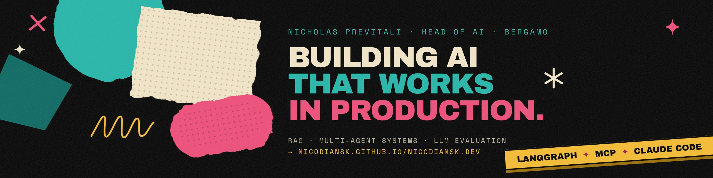
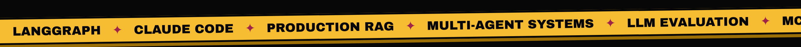

 

[-F3E6C8?style=for-the-badge&logo=readdotcv&logoColor=070707)](https://nicodiansk.github.io/nicodiansk.dev/docs/Nicholas_Previtali_CV.pdf)

I build AI systems that run in production, and I measure them before I call them done.

I lead the AI unit at **S.I. 2001** in Bergamo. With a small team of engineers I design and ship retrieval, multi-agent and evaluation systems for companies in HR, retail, financial services, industry, legal and e-commerce.

| **5** | **12** | **12K** | **8** |
|:---:|:---:|:---:|:---:|
| years in AI | AI projects since 2023 | employees on one AI assistant | industries |

## Selected work · 2023 – today

| Project | For | What we built | In numbers |
|---|---|---|---|
| **HR assistant** | European data & AI consultancy | Topic routing with hybrid search and an LLM reranker, document RAG with a faithfulness judge, five languages | **12K** employees · **88.5%** top-1 topic accuracy |
| **Sales-call analysis** | International credit insurer | Nightly transcription, speaker identification, objection catalogue, scoring per campaign, coaching | Coaching aimed at the wrong speaker **25% → 0%** |
| **Multi-agent planograms** | Global system integrator | LangGraph supervisor with specialist agents on top of an OR-Tools CP-SAT optimiser | **5** agents · **27** tools |
| **Team process platform** *(2026, in development)* | Software teams | One workspace for PMs, engineers and AI: shared docs, tasks, Gantt, PR/MR pre-reviews, with Claude as the engine | Docs, boards, tracker and Git **4 → 1** |
| **Privacy-first employee assistant** | Supermarket chain, Northern Italy | No memory or RAG, in-pod anonymiser, deployed inside the client's cluster under a security clearance | **7** types of personal data anonymised |
| **Technical RAG** | Industrial valve company | Corrective RAG with page-level citations over long manuals and standards | **708**-page standards |
| **Legal RAG and drafting** | Several Italian law firms | RAG over each firm's documents plus minutes and deeds drafted from DOCX templates | **300K+** documents |
| **GEO / SEO structured data** | E-commerce, an agency, a credit insurer | JSON-LD pipelines that search and AI engines can read | **3** clients |

Also: a recommender with RAG for a platform linking companies and non-profits, competitive intelligence on ad campaigns with a vision LLM, and text and photo search for a fashion catalogue.

Full case studies, with my role in each, are on the **[portfolio](https://nicodiansk.github.io/nicodiansk.dev/)**.

## Open source

**[Turbocharge](https://github.com/nicodiansk/turbocharge)**: a Claude Code plugin for test-driven, AI-assisted development. One pipeline, brainstorm → plan → build → review, with **10** skills, **6** agents and **2** hooks.

## How I work

- **Retrieval on real documents.** Hybrid search (full-text + vectors, RRF), LLM reranking and page-level citations before reaching for a bigger model.
- **Agents with one job each.** Single-scope agents with clear hand-offs; the LLM routes, the authoritative services decide.
- **Measure before shipping.** Test query sets, top-1 accuracy, faithfulness judges and before/after comparisons on the same data.
- **Guardrails and fallbacks.** Anonymisers before every model call, structured outputs, tool-call constraints and Langfuse tracing.

## Stack

**AI & LLMs**

**RAG & search**

**Evaluation**

**Engineering**

-F3E6C8?style=flat-square)

## Education

- **MSc Computer Engineering**, Università di Bergamo, 2019–2022, 110/110 cum laude. Thesis: *Extraction of Semantic Topological Maps from 2D Occupational Maps*.
- **BSc Computer Engineering**, Università di Bergamo, 2016–2019. Thesis on iridology analysis with computer vision.

## Off the clock

Tattoos, JDM cars and guitar solos nobody asked for.

Based in Bergamo, Italy · <a href="https://nicodiansk.github.io/nicodiansk.dev/">nicodiansk.github.io/nicodiansk.dev</a> · <a href="https://www.linkedin.com/in/nicholasprevitali">linkedin.com/in/nicholasprevitali</a>

